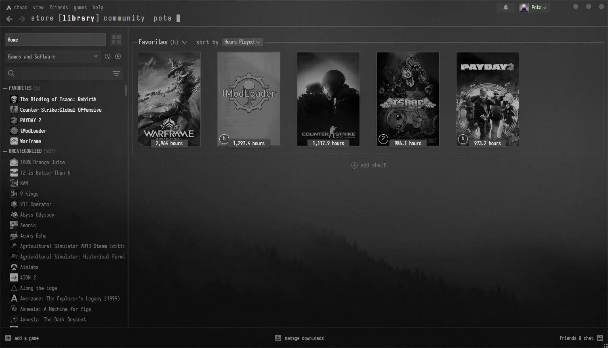
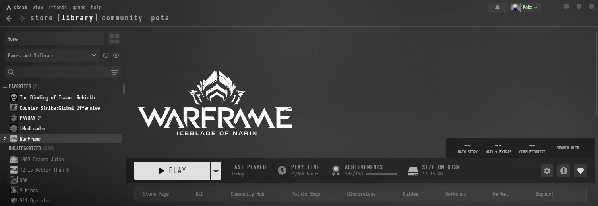
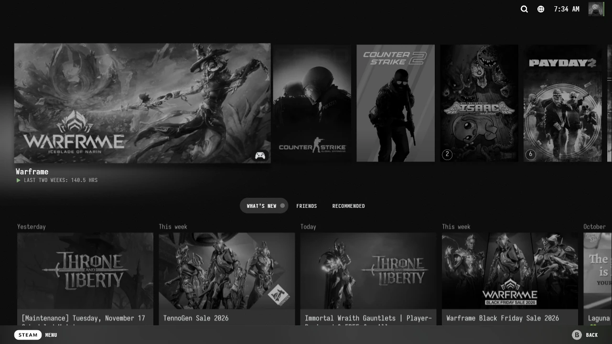

# steam-rice

Steam made to look like a tiling-WM Linux rice: a theme for [Millennium](https://steambrew.app). The sibling of [discord-rice](https://github.com/Plyxen/discord-rice), with the same wallpaper, font and greys.





![The steam-rice window on its look tab: a tab list on the left, block sliders for corners and wallpaper dim, choices as chips and [x] switches](assets/settings.webp)



## What it does

- **Tiled.** One misty wallpaper behind the library. The top bar, the game list, the page and the bottom bar are panes that touch, each with a thin border, as a tiling WM draws them. No gaps, gradients or shadows.
- **Its own settings window.** A rice bowl button in the top bar opens a small terminal-style settings tool inside Steam, with every option, sliders and `[x]` switches. Changes show straight away. See [Options](#options).
- **Terminal touches.** The open tab stands in `[brackets]` with a cursor blinking after the tabs, the open game has a `>` in front, and each shelf on the library home is a thin box with its name set into the top line. The Steam menu button wears your distro's logo: Arch by default, with nineteen others and Steam's own to pick from.
- **Greyscale.** Steam's blue-grey is gone everywhere: library, settings, menus, downloads, friends. Only things that mean something (playing, online, danger) keep a colour, muted.
- **Or tinted.** The settings window can give the greys a colour: one of your own, or the ones [matugen](https://github.com/InioX/matugen) takes from your wallpaper, followed live. See [Colours](#colours).
- **Quiet pictures.** Steam's library is a wall of cover art. Here covers are black-and-white and a little darker, and show their colours while the mouse is on them. People's avatars and their frames are left in colour. A game's page shows its logo on the wallpaper instead of a banner. The "What's New" strip is hidden.
- **Nothing moves.** Menus, tabs, the bell, your name, the window buttons and Play are where Steam has them, so your hand still finds them. The tabs and menus are lowercase, and the tabs are spaced out to the width of Steam's own. "Add shelf" sits under the shelves instead of above them. The window buttons are full size with a dot drawn in them, so the corner still closes the window.
- **Friends list and chat** have the same wallpaper, with their parts see-through and split by lines.
- **Big Picture mode** gets the wallpaper, the greys, the font and the quiet pictures. The game the controller is on shows its colours.
- **The in-game overlay** (Shift+Tab) is grey and in Iosevka like the rest, with flat buttons.
- **Iosevka everywhere,** small corners, thin scrollbars.
- **Store and community pages** are web pages with their own styles, so they only get the font, a neutral background and their colour turned down to sit next to the grey client. Profile pages keep their full colours, for the artwork on them.

## Light

What Steam loads is about 105 KB in six files, and it adds 147 style rules to Steam's twenty thousand. The whole download, screenshots included, is about 500 KB.

Steam has almost no colour variables. Its look is some eleven thousand literal colours in its own style sheets, so themes usually override them rule by rule, which gets large and breaks when Valve renames things. This theme doesn't add colour rules at all. `mono.js` reads Steam's style sheets once when Steam starts (about 0.15 s), rewrites the colours in the text, and gives every window the rewritten sheet in place of the original. Steam runs with the same number of rules as with no theme, and a Steam update needs nothing from you.

`rice.css` is the rest: wallpaper, pane borders, the terminal touches and the options. `settings.js` is the settings window; its own styles are only added to the main window, when the top bar is there. It names Steam's parts by the readable class names Millennium adds (`TopBar`, `SuperNav`, `BottomBar`), not by Valve's generated ones, so it survives updates too.

## Install

You need [Millennium](https://steambrew.app), with JavaScript allowed for themes (it asks when you pick the theme; the grey is the script).

It's in [Millennium's theme store](https://steambrew.app/theme/GNmVVC7pVltSHEouubpl). In Steam: **Steam menu → Millennium → Themes → Install a theme**, and enter this ID:

```
GNmVVC7pVltSHEouubpl
```

Then pick **steam-rice** in the same list. New versions show up under **Millennium → Updates**, with an Update button.

### By hand

Download this repo (**Code → Download ZIP**), unzip it, and put the folder into Millennium's themes folder as `steam-rice`. The themes folder is `millennium/themes` inside your Steam folder. Then pick it under **Steam menu → Millennium → Themes**. To update, download it again and replace the folder.

## Options

The easy way is inside Steam: the **rice bowl button** in the top bar, left of the bell, opens the steam-rice window, a small terminal-style settings tool with every option below. Changes show straight away, in every Steam window.

- Keys: `1`-`4` pick a tab, `Tab` moves, `Space` toggles, `←` `→` move a slider, `Esc` closes.
- What you pick there is laid over the theme settings in Millennium, not written into them. **reset defaults** (click it twice) forgets it all and hands the theme back to Millennium.
- Four things are only in the window: sliders for corners and wallpaper dim that go finer than Millennium's three steps, a wallpaper blur slider for the look of a see-through terminal on a blurring compositor, a field for a link to your own wallpaper, and [colours](#colours).
- Store and community pages are web pages of their own, which the window can't reach. That one option is set in Millennium.

The same options are in Millennium: open the theme's settings (the cog next to it).

| Option | Choices | |
| --- | --- | --- |
| Font | Iosevka, Steam | |
| Corners | Sharp, Small, Round | |
| Pane borders | on, off | A thin border around every pane. Off gives plain lines. |
| Wallpaper dim | Light, Medium, Heavy | Go heavier if text is hard to read. |
| Film grain | on, off | |
| Pictures | Quiet, Grey, Steam | Grey is Quiet without the colour under the mouse. Steam is the stock look. |
| Store and community pages | Muted, Greyscale, Steam | |
| Logo | Arch, CachyOS, EndeavourOS, Manjaro, Artix, Garuda, Debian, Ubuntu, Mint, Pop!_OS, Zorin, Kali, Fedora, Nobara, openSUSE, NixOS, Gentoo, Void, Alpine, Tux, Steam | The logo on the Steam menu button. |
| Lowercase tabs | on, off | |
| Dots in the window buttons | on, off | |
| Hide megaphone and Big Picture buttons | on, off | |
| Hide What's New | on, off | |

A few more are at the top of `rice.css`, each with a comment: your own wallpaper (`--wallpaper`), its blur (`--wallpaper-blur`), the edge distance of the game list and bottom bar (`--inset`), and hiding "Add shelf" and "Add a Game".

Smaller covers are Steam's own setting: **Settings → Library → Library user interface display size → Small**.

### Colours

The theme is grey. **colours** on the window's look tab can tint it:

- **custom** takes one colour, typed as `#rrggbb`.
- **matugen** takes the colours [matugen](https://github.com/InioX/matugen) makes from your wallpaper.

Text and menus get a little of the colour. The pane borders, the logo, the brackets and the cursor in the top bar, the `>` in the game list, and Steam's buttons and bars get more. How light each thing is stays as it is in grey, so text reads as well as before. Store and community pages are not tinted.

For matugen, add a template to its `config.toml`. The paths are for Linux, where Millennium keeps themes in `~/.steam/steam/steamui/skins`:

```toml
[templates.steam-rice]
input_path = '~/.steam/steam/steamui/skins/steam-rice/matugen/steam-rice.json'
output_path = '~/.steam/steam/steamui/skins/steam-rice/matugen.json'
```

Then pick **matugen** in the window. Steam looks at `matugen.json` every few seconds while its main window is open, so it follows a new wallpaper without a restart.

The template takes `surface` for the tint and `primary` for the accent. For other colours, copy it, change the two names and point `input_path` at your copy. `matugen.json` is yours, not part of the theme: if Steam is grey again after a theme update, run matugen once more.

## Licence

GPL-3.0-or-later, see `LICENSE`. Iosevka by Belleve Invis (SIL Open Font License 1.1) is loaded from jsDelivr, not included. The distro logos' outlines are from Simple Icons (CC0). The logos themselves are trademarks of their projects, and this theme is not affiliated with any of them.
