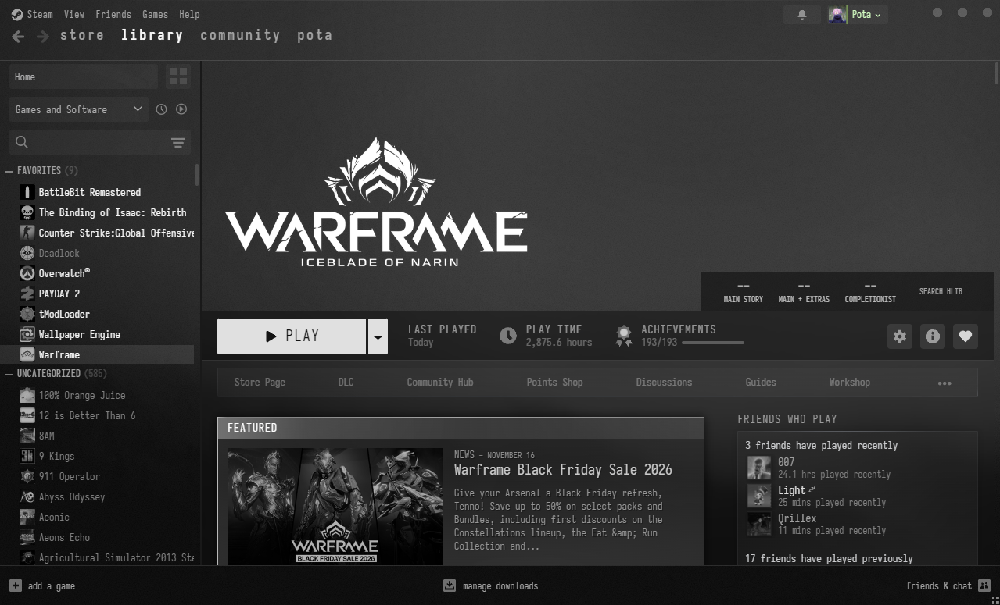

# steam-rice

Steam made to look like a tiling-WM Linux rice: a theme for [Millennium](https://steambrew.app). The sibling of [discord-rice](https://github.com/Plyxen/discord-rice), with the same wallpaper, font and greys.

## What it does

- **Tiled, no boxes.** One misty wallpaper behind the library, with the game list, the page and the bars split by 1px lines. No gradients or shadows.
- **Greyscale.** Steam's blue-grey is gone everywhere: library, settings, menus, downloads, friends. Only things that mean something (playing, online, danger) keep a colour, muted.
- **Quiet pictures.** Steam's library is a wall of cover art. Here covers are black-and-white and a little darker, and show their colours while the mouse is on them. People's avatars and their frames are left in colour. A game's page shows its logo on the wallpaper instead of a banner. The "What's New" strip is hidden.
- **Nothing moves.** Menus, tabs, the bell, your name, the window buttons and Play are where Steam has them, so your hand still finds them. The tabs are lowercase and spaced out to the width of Steam's own. The window buttons are full size with a dot drawn in them, so the corner still closes the window.
- **Friends list and chat** have the same wallpaper, with their parts see-through and split by lines.
- **Big Picture mode** gets the wallpaper, the greys, the font and the quiet pictures. The game the controller is on shows its colours.
- **The in-game overlay** (Shift+Tab) is grey and in Iosevka like the rest, with flat buttons.
- **Iosevka everywhere,** small corners, thin scrollbars.
- **Store and community pages** are web pages with their own styles, so they only get the font, a neutral background and their colour turned down to sit next to the grey client. Profile pages keep their full colours, for the artwork on them.

## Light

About 60 KB in five files, and it adds 121 style rules to Steam's twenty thousand.

Steam has almost no colour variables. Its look is some eleven thousand literal colours in its own style sheets, so themes usually override them rule by rule, which gets large and breaks when Valve renames things. This theme doesn't add colour rules at all. `mono.js` reads Steam's style sheets once at start (about 40 ms), rewrites the colours in the text, and gives every window the rewritten sheet in place of the original. Steam runs with the same number of rules as with no theme, and a Steam update needs nothing from you.

`rice.css` is the rest: wallpaper, lines and the options. It names Steam's parts by the readable class names Millennium adds (`TopBar`, `SuperNav`, `BottomBar`), not by Valve's generated ones, so it survives updates too.

## Install

You need [Millennium](https://steambrew.app), with JavaScript allowed for themes (it asks when you pick the theme; the grey is the script).

Download this repo (**Code → Download ZIP**), unzip it, and put the folder into Millennium's themes folder as `steam-rice`. The themes folder is `millennium/themes` inside your Steam folder.

Then in Steam: **Steam menu → Millennium → Themes → steam-rice**.

### Updates

Download it again and replace the folder. Once the theme is in Millennium's store, Millennium installs it and keeps it up to date for you.
## Options

In Millennium, open the theme's settings (the cog next to it).

| Option | Choices | |
| --- | --- | --- |
| Font | Iosevka, Steam | |
| Corners | Sharp, Small, Round | |
| Wallpaper dim | Light, Medium, Heavy | Go heavier if text is hard to read. |
| Film grain | on, off | |
| Pictures | Quiet, Grey, Steam | Grey is Quiet without the colour under the mouse. Steam is the stock look. |
| Store and community pages | Muted, Greyscale, Steam | |
| Lowercase tabs | on, off | |
| Dots in the window buttons | on, off | |
| Hide megaphone and Big Picture buttons | on, off | |
| Hide What's New | on, off | |

A few more are at the top of `rice.css`, each with a comment: your own wallpaper (`--wallpaper`), the edge distance of the game list and bottom bar (`--inset`), and hiding "Add shelf" and "Add a Game".

Smaller covers are Steam's own setting: **Settings → Library → Library user interface display size → Small**.

## Licence

GPL-3.0-or-later, see `LICENSE`. Iosevka by Belleve Invis (SIL Open Font License 1.1) is loaded from jsDelivr, not included.
