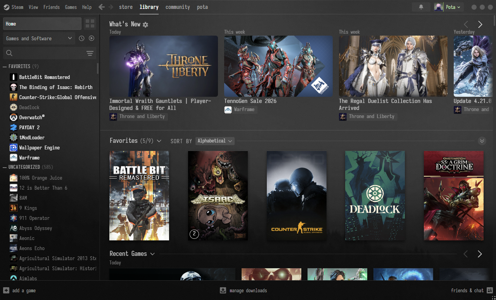

# steam-rice

Steam made to look like a tiling-WM Linux rice: a theme for [Millennium](https://steambrew.app). The sibling of [discord-rice](https://github.com/Plyxen/discord-rice), with the same wallpaper, font and greys.



## What it does

- **Tiled, no boxes.** One misty wallpaper behind the library, with the game list, the page and the bars split by 1px lines. No gradients or shadows.
- **Greyscale.** Steam's blue-grey is gone everywhere: library, settings, menus, downloads, friends. Game art keeps its colour. Only things that mean something (playing, online, danger) keep a colour, muted.
- **One thin top bar.** Menus, tabs and window buttons share a single row: `Steam View Friends Games Help  store library community you`. The tabs are small and lowercase, and the open one is marked on the bar's own line.
- **On a grid.** Everything in the top bar sits on one centre line. The first menu, the game list's boxes, the bottom bar's icons and the window dots keep the same 8px from the window's edge.
- **Window dots.** Three small dots instead of `- [] x`. They light up under the mouse.
- **Iosevka everywhere,** small corners, thin scrollbars.
- **Less clutter.** The megaphone and Big Picture buttons and the "Add shelf" row are hidden.
- **Store and community pages** are web pages with their own styles, so they only get the font, a neutral background and their colour turned down to sit next to the grey client.

## Light

About 50 KB in five files, and it adds 92 style rules to Steam's twenty thousand.

Steam has almost no colour variables. Its look is some eleven thousand literal colours in its own style sheets, so themes usually override them rule by rule, which gets large and breaks when Valve renames things. This theme doesn't add colour rules at all. `mono.js` reads Steam's style sheets once at start (about 40 ms), rewrites the colours in the text, and gives every window the rewritten sheet in place of the original. Steam runs with the same number of rules as with no theme, and a Steam update needs nothing from you.

`rice.css` is the rest: layout, wallpaper, lines and the options. It names Steam's parts by the readable class names Millennium adds (`TopBar`, `SuperNav`, `BottomBar`), not by Valve's generated ones, so it survives updates too.

## Install

You need [Millennium](https://steambrew.app), with JavaScript allowed for themes (it asks when you pick the theme; the grey is the script).

Windows, in PowerShell:

```powershell
irm https://raw.githubusercontent.com/Plyxen/steam-rice/main/install.ps1 | iex
```

Or download the repo and run `install.ps1` from its folder. Either way it only copies the theme into `Steam\millennium\themes\steam-rice`. Run it again to update.

By hand, on any system: put this folder into Millennium's themes folder as `steam-rice`.

Then in Steam: **Steam menu → Millennium → Themes → steam-rice**.

## Options

In Millennium, open the theme's settings (the cog next to it).

| Option | Choices | |
| --- | --- | --- |
| Font | Iosevka, Steam | |
| Corners | Sharp, Small, Round | |
| Wallpaper dim | Light, Medium, Heavy | Go heavier if text is hard to read. |
| Film grain | on, off | |
| Black-and-white game art | Off, On, Hover | Hover shows a picture in colour under the mouse. |
| Store and community pages | Muted, Greyscale, Steam | |
| One-row top bar | on, off | Off gives Steam's two rows back. |
| Window buttons as dots | on, off | |
| Hide megaphone and Big Picture buttons | on, off | |
| Hide What's New | off, on | |

A few more are at the top of `rice.css`, each with a comment: your own wallpaper (`--wallpaper`), the edge distance (`--inset`), lowercase tabs, and hiding "Add shelf" and "Add a Game".

## Not done yet

- Big Picture mode and the in-game overlay are left as Steam draws them, apart from the grey.
- The friends list and chat are grey and in Iosevka, but have no wallpaper yet.
- No installer for Linux or macOS. Copy the folder by hand there.

## Licence

GPL-3.0-or-later, see `LICENSE`. Iosevka by Belleve Invis (SIL Open Font License 1.1) is loaded from jsDelivr, not included.
